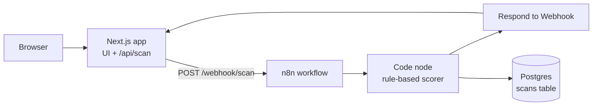

# Scam Radar

Paste a suspicious SMS or WhatsApp message and get an instant verdict (`likely_safe`, `suspicious`, or `scam`) with the reasons behind it. Built for the kinds of scams common in Pakistan (fake JazzCash/Easypaisa alerts, BISP and prize messages, job scams).

The goal of this project is to ship a small product end to end: workflow automation, a full-stack app, containers, and a CI/CD pipeline.

## Architecture



1. The user submits a message in the Next.js UI.
2. The API route validates it and forwards it to an n8n webhook (the n8n URL is never exposed to the browser).
3. n8n scores the message, returns the verdict immediately, and saves the result to Postgres in a parallel branch.
4. Only the verdict, score, reasons, and links are stored, never the raw message.

## Tech stack

| Layer | Tools |
|---|---|
| Frontend + backend | Next.js (App Router), API routes |
| Automation | n8n (self-hosted, Docker) |
| Database | PostgreSQL 16 |
| Containers | Docker, Docker Compose, multi-stage build |
| CI/CD | GitHub Actions, GHCR, self-hosted runner |

## CI/CD pipeline

Every push to `main` triggers four jobs:

| Job | Runs on | What it does |
|---|---|---|
| `web` | GitHub-hosted | Install, lint, unit tests, production build |
| `guards` | GitHub-hosted | Validates `workflows/scan.json`, fails if `.env` is ever tracked |
| `publish` | GitHub-hosted | Builds the Docker image and pushes it to GHCR (`latest` + commit SHA tags) |
| `deploy` | Self-hosted | Pulls the new image and restarts the web container |

`publish` only runs after `web` and `guards` pass, and `deploy` only runs after `publish`. Pull requests run the checks but never publish or deploy.

## Scoring rules

| Signal | Points |
|---|---|
| Urgency or fear wording | 20 |
| Promises money or prizes | 25 |
| Asks for OTP, CNIC, password | 30 |
| Job-scam wording | 20 |
| Shortened link | 20 |
| Suspicious domain ending | 15 |
| Link uses a raw IP address | 25 |

Score is capped at 100. `>= 60` is `scam`, `>= 30` is `suspicious`, otherwise `likely_safe`. The same logic lives in `web/lib/score.mjs` (unit tested) and in the n8n Code node.

## Run locally

Requirements: Docker Desktop, Node 20+.

1. Create `.env` from `.env.example` and fill in the values (generate secrets with a random 64-character hex string):
   ```
   DB_USER=n8n
   DB_PASSWORD=
   DB_NAME=n8n
   N8N_ENCRYPTION_KEY=
   ```
2. Start the stack:
   ```
   docker compose up -d
   ```
3. Open n8n at `http://localhost:5678`, create the owner account, and paste the contents of `workflows/scan.json` onto a new workflow canvas.
4. Add a Postgres credential (host `postgres`, database `n8n`, your user and password, port `5432`, SSL disabled), select it in the Postgres node, and **Publish** the workflow.
5. Create the table:
   ```
   docker compose exec postgres psql -U n8n -d n8n -c "CREATE TABLE scans (id SERIAL PRIMARY KEY, verdict TEXT, score INT, reasons TEXT, urls TEXT, created_at TIMESTAMPTZ DEFAULT now());"
   ```
6. Open `http://localhost:3000` and scan a message.

Run the tests with `cd web && npm test`.

## Project structure

```
.
├── .github/workflows/ci.yml   # CI/CD pipeline
├── docker-compose.yml         # web + n8n + postgres
├── workflows/scan.json        # exported n8n workflow
└── web/
    ├── app/                   # Next.js UI and /api/scan route
    ├── lib/score.mjs          # scoring logic (unit tested)
    └── Dockerfile             # multi-stage production image
```

## Security notes

- Secrets live in `.env` (git-ignored); CI fails if `.env` is ever committed.
- Only the web app is exposed publicly; the n8n admin port is never tunneled.
- Raw messages are not stored.

## Roadmap

- LLM second opinion for borderline (`suspicious`) messages
- Trends dashboard from the `scans` table
- Rate limiting on `/api/scan`
- Deploy to a hosted server